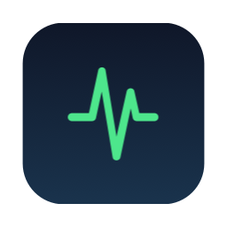
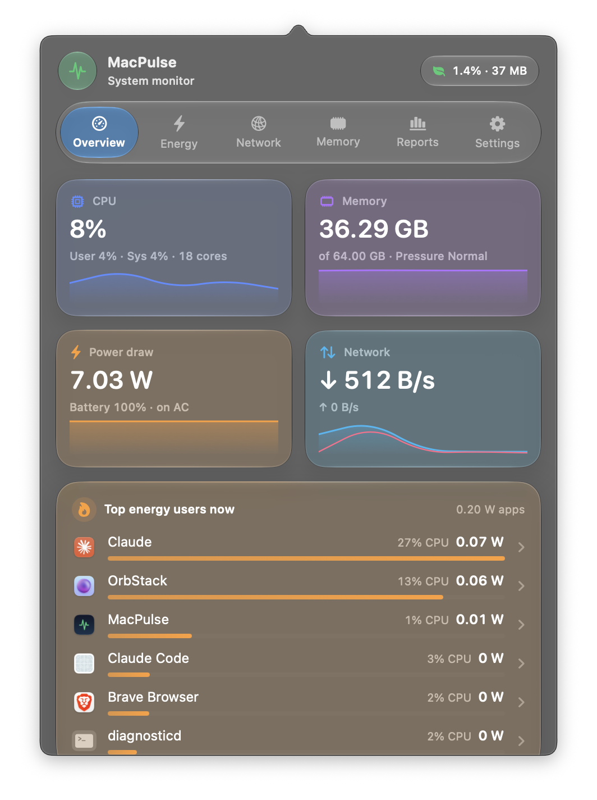
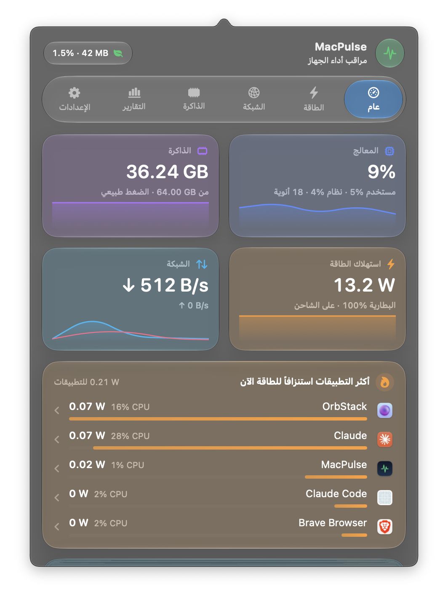
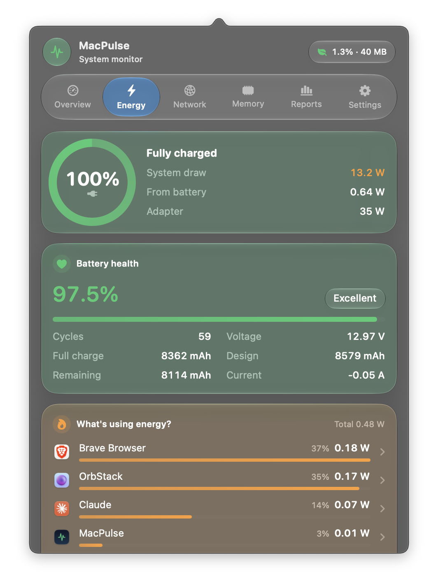
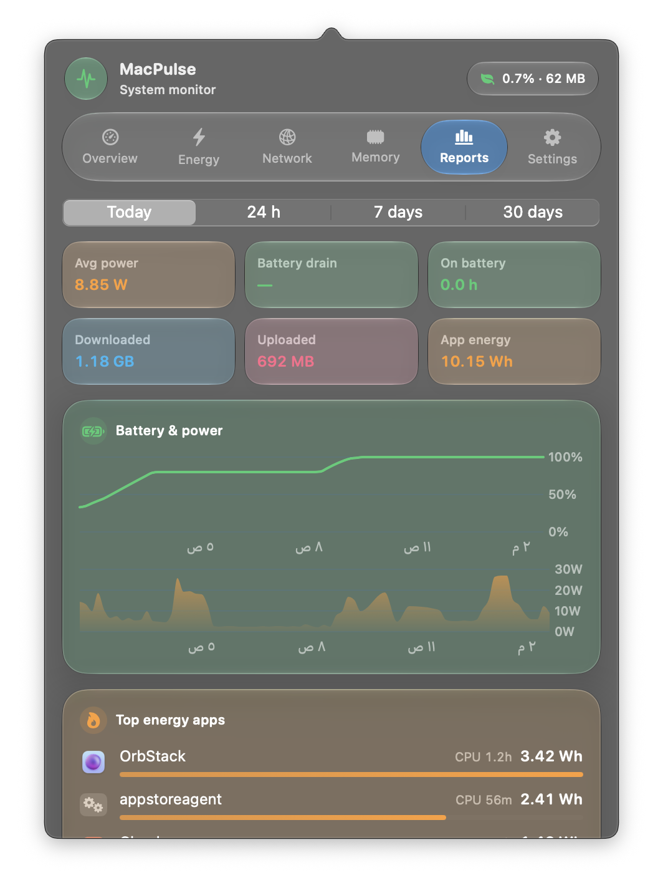
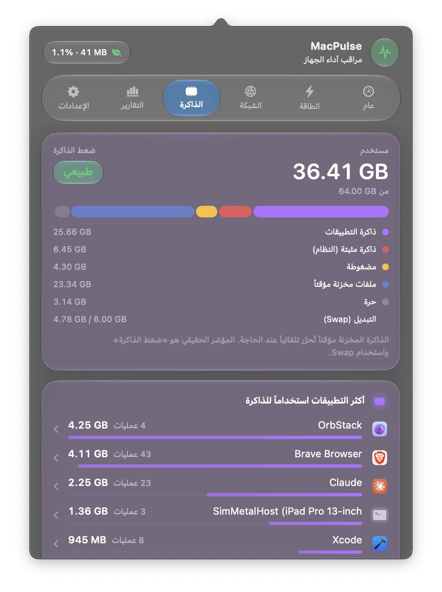
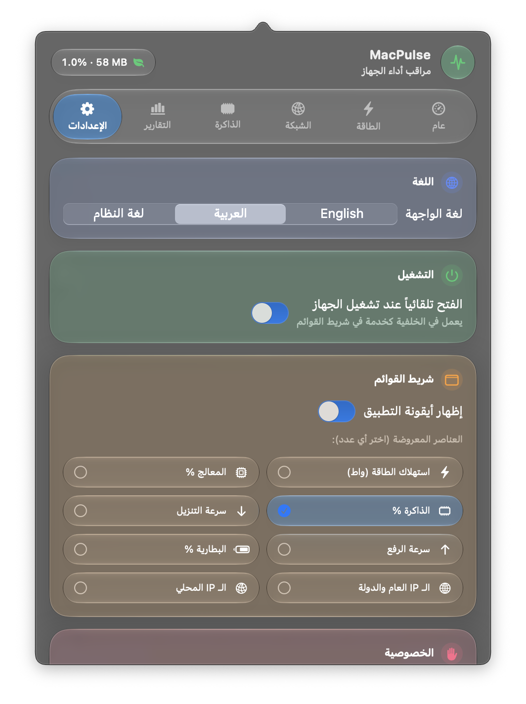

<div align="center">



# MacPulse

**A featherweight macOS menu-bar monitor for energy, battery, network, CPU and memory — with a read-only MCP server so Claude can analyse your Mac.**

**مراقب أداء خفيف جداً لشريط القوائم في الماك: الطاقة والبطارية والشبكة والمعالج والذاكرة — مع خادم MCP للقراءة فقط ليحلل Claude بيانات جهازك.**

Swift · SwiftUI · Liquid Glass · العربية / English · ≈0.1% CPU idle · 19 MB

[**Download / تحميل**](../../releases/latest) · [English](#english) · [العربية](#العربية)


</div>

| Overview | النظرة العامة | Energy | Reports |
|---|---|---|---|
|  |  |  |  |

| الذاكرة | الإعدادات |
|---|---|
|  |  |

---

## English

### Features
- **Energy & battery** — whole-machine power draw (W), per-app energy from kernel counters, CPU wakeups, battery health, cycles, capacity, charger wattage.
- **Network** — live throughput per interface, **per-app traffic**, and **which servers** each app talks to (reverse DNS optional).
- **CPU & memory** — memory pressure, swap, breakdown, per-app footprint; helper processes grouped under their app.
- **Reports** — today / 24 h / 7 d / 30 d: battery & power charts, drain %/h, top apps by energy and network, top destinations, CSV export.
- **Menu bar** — pick any combination: power, CPU, memory, ↓/↑ speed, battery, **public IP + country flag** (opt-in), local IP.
- **Arabic & English** — follows the system language or set manually; full RTL layout.
- **Liquid Glass** design on macOS 26+, material fallback on macOS 14–15.
- **Launch at login** via `SMAppService`.

### Install
1. Download `MacPulse.zip` from [Releases](../../releases/latest), unzip, move **MacPulse.app** to **/Applications**.
2. The build is ad-hoc signed (not notarized). On first launch, **right-click → Open**, or run:
   ```bash
   xattr -dr com.apple.quarantine /Applications/MacPulse.app
   ```

### Build from source
```bash
scripts/build-app.sh            # → build/MacPulse.app (universal, ad-hoc signed)
scripts/build-app.sh --install  # copy to /Applications and launch
swift test                      # security & robustness tests
```
Requires macOS 14+ and Xcode 16+ (tested on Apple Silicon, Xcode 27, Swift 6.4).

### MCP server (read-only) — let Claude analyse your Mac
```bash
claude mcp add --scope user macpulse -- "/Applications/MacPulse.app/Contents/MacOS/MacPulse" --mcp
```
Or **Settings → AI assistants (MCP) → Add to Claude Desktop** (merges into the existing config and keeps a `.bak`).

| Tool | Reads |
|---|---|
| `get_live_status` | CPU, memory, battery, network now; top energy & memory apps |
| `get_battery` | charge, health, cycles, voltage, current, charger |
| `get_memory` | breakdown, pressure, swap, top apps |
| `get_top_apps` | rank apps by energy / energy on battery / CPU / network / memory |
| `get_network_destinations` | servers each app talked to (can be disabled) |
| `get_history` | time series of battery, power, CPU, memory, network |
| `get_battery_report` | drain %/h, hours on battery, avg/peak power |

Every tool is `readOnlyHint`; the database is opened `SQLITE_OPEN_READONLY` + `PRAGMA query_only`; stdio only (no network port); no tool runs commands or writes files. ChatGPT currently connects only to remote (internet-facing) MCP servers, so it isn't enabled — your data stays local.

### How it works
| Data | Source (no root, no kernel extension) |
|---|---|
| Battery & system power | IORegistry `AppleSmartBattery` (`PowerTelemetryData.SystemLoad`) |
| Per-app energy / CPU / wakeups / memory | `proc_pid_rusage(RUSAGE_INFO_V6)` → `ri_energy_nj`, `ri_phys_footprint` |
| Interface totals | `sysctl(NET_RT_IFLIST2)` 64-bit counters |
| Per-app network & destinations | one long-lived `/usr/bin/nettop` on a pty, supervised by a kqueue guard |
| History | SQLite (WAL), written once a minute, `0700`/`0600` permissions |

### Measured cost (1,847 processes)
| State | CPU | Memory |
|---|---|---|
| Panel closed (10 s sampling) | ≈0.1–0.25 % | 19 MB |
| Panel open (2 s sampling) | ≈1.2 % | 38–49 MB steady |

### Privacy & security
Nothing leaves your Mac unless you enable **reverse DNS** or **public IP** lookup (ipinfo.io, only on network change or every 30 min). Hardened runtime, no entitlements, hostile-input tests for the nettop parser, CSV formula-injection protection, validated IP-service responses.

### Known limitations
- ~300 protected system processes (WindowServer, kernel_task) can't be read without root.
- Per-app energy is CPU energy; display/GPU are only in the system total.
- Connections shorter than one sample show as "unattributed".
- Intel Macs are untested.

---

## العربية

### المزايا
- **الطاقة والبطارية:** استهلاك الجهاز الكلي بالواط، وطاقة كل تطبيق من عدادات النواة، ومرات إيقاظ المعالج، وصحة البطارية والدورات والسعة وقدرة الشاحن.
- **الشبكة:** السرعة لكل واجهة، والاستخدام **لكل تطبيق**، و**إلى أي خوادم** يتصل كل تطبيق.
- **المعالج والذاكرة:** ضغط الذاكرة و Swap والتفصيل والذاكرة لكل تطبيق، مع تجميع العمليات المساعدة تحت تطبيقها.
- **التقارير:** اليوم / 24 ساعة / 7 أيام / 30 يوم، مع رسوم البطارية والطاقة، ومعدل التصريف بالساعة، وأكثر التطبيقات والوجهات، وتصدير CSV.
- **شريط القوائم:** اختر أي عدد من العناصر: الطاقة، المعالج، الذاكرة، التنزيل والرفع، البطارية، **الـ IP العام مع علم الدولة** (اختياري)، الـ IP المحلي.
- **عربي وإنجليزي** حسب لغة النظام أو يدوياً، مع اتجاه كامل من اليمين لليسار.
- **تصميم Liquid Glass** على macOS 26+.
- **الفتح عند تشغيل الجهاز.**

### التثبيت
1. حمّل `MacPulse.zip` من [الإصدارات](../../releases/latest)، وفك الضغط، وانقل **MacPulse.app** إلى **التطبيقات**.
2. التطبيق موقّع محلياً وغير موثّق من Apple، فأول مرة اضغط عليه **بالزر الأيمن ← فتح**، أو نفّذ:
   ```bash
   xattr -dr com.apple.quarantine /Applications/MacPulse.app
   ```

### MCP: ربطه مع Claude (قراءة فقط)
من **الإعدادات ← الذكاء الاصطناعي (MCP)** تقدر تضيفه لـ Claude Desktop بضغطة، أو تنسخ أمر Claude Code. المساعد يقرأ البيانات ويحللها فقط، ولا يستطيع تغيير أي شيء أو تشغيل أوامر.

### الأمان والأداء
- لا يحتاج صلاحيات root ولا entitlements، و Hardened Runtime مفعّل.
- لا يخرج شيء من جهازك إلا إذا فعّلت **DNS العكسي** أو **الـ IP العام**.
- مجلد السجل `0700` وملفاته `0600`.
- محلل nettop محمي من الأسماء المزيفة والأرقام الضخمة.
- تصدير CSV محمي من حقن الصيغ.
- رد خدمة الـ IP يُتحقق منه قبل عرضه.
- الرسوم الحية تُرسم على المعالج كصورة صغيرة بدل ذاكرة كرت الرسوم (كانت تحجز ~185 MB مع كل تحديث).

## License
No license has been chosen yet — all rights reserved by the author.
